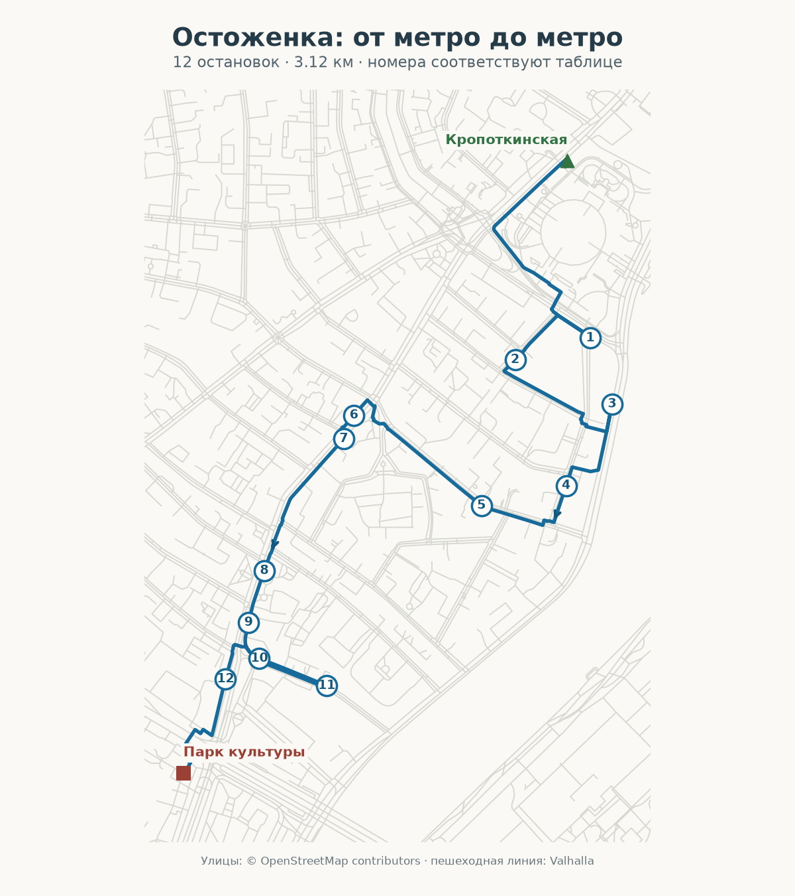

# Остоженка: искусство и частная жизнь

Этап: тексты и пешеходная линия подготовлены; аудио, общая ссылка и публикация отсутствуют. Серверный SSH-доступ после перезапуска не восстановлен.

Старт: **Москва, метро «Кропоткинская», выход 2 к Храму Христа Спасителя**. Финиш: **Москва, метро «Парк культуры», выход 1, Сокольническая и Кольцевая линии**.

12 самостоятельных физических остановок, 3 117 м по пешеходной линии, 39 минут ходьбы без прослушивания и осмотра. Объём сценария: 2 151 слово. Планируйте 80–100 минут на прогулку; 15 минут аудио должны быть отдельно подтверждены после синтеза.

## Остановки

| № | Рассказ | Адрес | Слов |
|---:|---|---|---:|
| 1 | [Дом Перцовой: художники и «Мурава»](https://otgolosok.online/?place=osm:node:7428358397) | Москва, Курсовой переулок, дом 1 | 238 |
| 2 | [Илия Обыденный: храм, который отстояли прихожане](https://otgolosok.online/?place=osm:relation:18096252) | г. Москва, 2-й Обыденский пер., д. 6/3, стр. 1 | 196 |
| 3 | [Цветковская галерея: собрание в красном тереме](https://otgolosok.online/?place=osm:way:52434941) | Москва, Пречистенская набережная, дом 29, строение 1 | 190 |
| 4 | [Пречистенские курсы: рабочие за партами](https://otgolosok.online/?place=osm:node:12233205875) | Москва, Курсовой переулок, дом 17, строение 1 | 175 |
| 5 | [Сергей Мицкевич: врач и директор музея](https://otgolosok.online/?place=osm:node:12236419787) | Москва, 1-й Зачатьевский переулок, дом 13 | 149 |
| 6 | [Мультимедиа Арт Музей: старый фасад и новые залы](https://otgolosok.online/?place=osm:way:193498236) | Москва, улица Остоженка, дом 16 | 122 |
| 7 | [Доходный дом Кекушевой: каштаны на фасаде](https://otgolosok.online/?place=osm:way:47978268) | Москва, улица Остоженка, дом 19, строение 1 | 157 |
| 8 | [Тургенев на Остоженке: семья и литературная работа](https://otgolosok.online/?place=osm:way:76618921) | Москва, ул. Остоженка, д. 37/7, стр. 1 | 241 |
| 9 | [Дом Всеволожских: деревянные колонны и усадебный двор](https://otgolosok.online/?place=osm:relation:1850015) | Москва, улица Остоженка, дом 49, строение 1 | 135 |
| 10 | [Усадьба Скосыревой и Абрикосовых](https://otgolosok.online/?place=osm:way:76633316) | Москва, улица Остоженка, 51, строение 1 | 161 |
| 11 | [Старообрядческий храм: история двух названий](https://otgolosok.online/?place=osm:way:76633314) | Москва, Турчанинов переулок, дом 4, строение 1 | 183 |
| 12 | [Музей Москвы](https://otgolosok.online/?place=osm:relation:6011324) | Москва, Зубовский бульвар, 2, ансамбль Провиантских складов | 204 |

Ссылки в таблице открывают исходные карточки каталога. Новая редакция находится в этом пакете и ещё не импортирована.

## Материалы

- [Все рассказы](stories.md) и [структурированный пакет](stories.json).
- [Документ прогулки](walk.json) со стабильными job UUID, физическими placeId, триггерами и пешеходной линией.
- [Пересечения](overlap.json): 0% с каждым из 25 текущих маршрутов и остальных 12 вариантов общего плана.
- [Геометрия](geometry-verification.json): центры и триггеры внутри Садового; завершающий подход к метро частично снаружи, как согласовано с пользователем.
- [Аудит Opus 5.5, исправления и условия продолжения](../ostozhenka-povarskaya-2026-10-07/README.md).

## Перед выпуском

Полевая доступность не проверена: `fieldChecked:false`. Рассказы слушаются с улицы; посещение музеев необязательно. Порог готовности — 900 секунд фактического аудио этой редакции, при подтверждённых провайдере ElevenLabs, модели v4 для новых записей и голосе «Отголосок2». Старые записи каталога не входят в новый хронометраж.

Музей Москвы сообщает о ремонте фасадов. Это отмечено в навигационной подсказке; видимость и доступность тротуара уточняются на месте.
