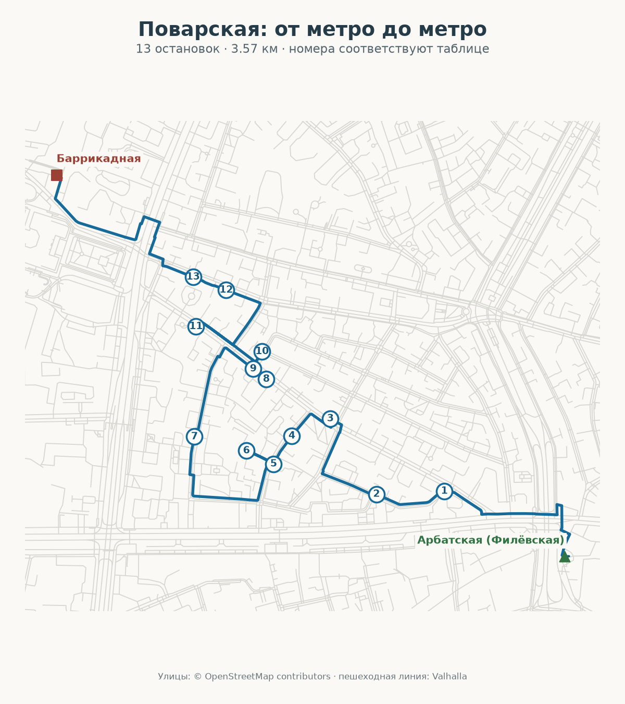

# Поварская: литература, музыка и особняки

Этап: тексты и пешеходная линия подготовлены; аудио, общая ссылка и публикация отсутствуют. Серверный SSH-доступ после перезапуска не восстановлен.

Старт: **Москва, метро «Арбатская» Филёвской линии, выход 1 на Арбатскую площадь**. Финиш: **Москва, метро «Баррикадная», выход 2 на Баррикадную улицу**.

13 самостоятельных физических остановок, 3 569 м по пешеходной линии, 44 минут ходьбы без прослушивания и осмотра. Объём сценария: 2 262 слова. Планируйте 80–100 минут на прогулку; 15 минут аудио должны быть отдельно подтверждены после синтеза.

## Остановки

| № | Рассказ | Адрес | Слов |
|---:|---|---|---:|
| 1 | [Усадьба Грачёвых: фабрикант и архитекторы](https://otgolosok.online/?place=osm:way:47294368) | Москва, Поварская улица, д. 7, стр. 1 | 213 |
| 2 | [Дом-музей М. Ю. Лермонтова](https://otgolosok.online/?place=osm:way:300426887) | Дом-музей М. Ю. Лермонтова, Москва, улица Малая Молчановка, 2 | 260 |
| 3 | [Елена Гнесина: квартира внутри академии](https://otgolosok.online/?place=osm:node:3423510101) | Москва, Поварская улица, 30/36, строение 1 | 315 |
| 4 | [Посольство Литвы в Москве](https://otgolosok.online/?place=osm:way:160317025) | Москва, Борисоглебский переулок, 10 | 85 |
| 5 | [Дом-музей Марины Цветаевой](https://otgolosok.online/?place=osm:way:300426888) | Москва, Борисоглебский переулок, дом 6, строение 1 | 183 |
| 6 | [Борисоглебский переулок у посольства Монголии](https://otgolosok.online/?place=osm:way:32783700) | Москва, Борисоглебский переулок, 11А, строение 1 | 118 |
| 7 | [Остроухов: домашняя коллекция становится музеем](https://otgolosok.online/?place=osm:node:3466483914) | Москва, Трубниковский переулок, д. 17 | 176 |
| 8 | [Горький на Поварской: литературный музей в усадьбе](https://otgolosok.online/?place=osm:way:47296416) | Москва, улица Поварская, дом 25А | 193 |
| 9 | [Дом Шереметьева: чтение «Полтавы»](https://otgolosok.online/?place=osm:relation:18626008) | Москва, Поварская ул., д. 27 | 166 |
| 10 | [Особняк Понизовского: модерн после переделки](https://otgolosok.online/?place=osm:way:47296531) | Москва, Поварская улица, дом 42, строение 1 | 137 |
| 11 | [Мастерская «12» Никиты Михалкова](https://otgolosok.online/?place=osm:way:46525731) | Москва, Поварская улица, дом 33, строение 1 | 112 |
| 12 | [Центральный дом литераторов: корпус на Большой Никитской](https://otgolosok.online/?place=osm:way:47031131) | Москва, Большая Никитская улица, 53 | 131 |
| 13 | [Усадьба Долгоруковых и Соллогуба: два уличных фронта](https://otgolosok.online/?place=osm:way:47031092) | Москва, Поварская улица, 52/55, строение 1 | 173 |

Ссылки в таблице открывают исходные карточки каталога. Новая редакция находится в этом пакете и ещё не импортирована.

## Материалы

- [Все рассказы](stories.md) и [структурированный пакет](stories.json).
- [Документ прогулки](walk.json) со стабильными job UUID, физическими placeId, триггерами и пешеходной линией.
- [Пересечения](overlap.json): 0% с каждым из 25 текущих маршрутов и остальных 12 вариантов общего плана.
- [Геометрия](geometry-verification.json): центры и триггеры внутри Садового; завершающий подход к метро частично снаружи, как согласовано с пользователем.
- [Аудит Opus 5.5, исправления и условия продолжения](../ostozhenka-povarskaya-2026-10-07/README.md).

## Перед выпуском

Полевая доступность не проверена: `fieldChecked:false`. Рассказы слушаются с улицы; посещение музеев необязательно. Порог готовности — 900 секунд фактического аудио этой редакции, при подтверждённых провайдере ElevenLabs, модели v4 для новых записей и голосе «Отголосок2». Старые записи каталога не входят в новый хронометраж.

У посольства Монголии триггер расположен перед въездом. К дому Остроухова нужен обход через Большую Молчановку; проход через посольскую территорию не требуется. ЦДЛ посещается до усадьбы Долгоруковых и Соллогуба.
